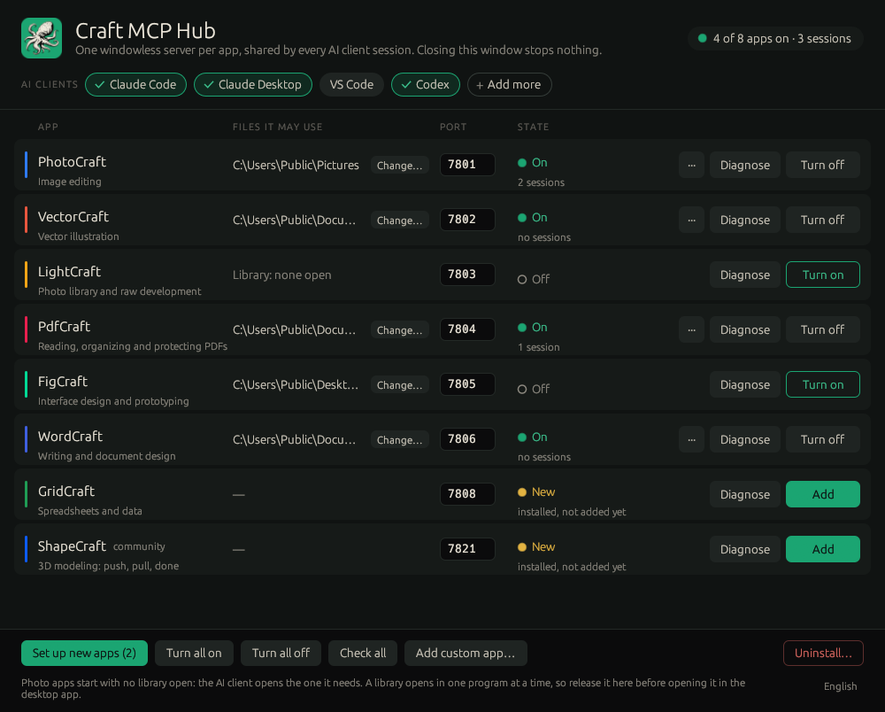

<p align="center">
  
</p>

<h1 align="center">Craft MCP Hub</h1>

<p align="center">
  <strong>One shared, windowless MCP server per <a href="https://getartcraft.com">ArtCraft</a> app, for every AI client session.</strong>
</p>

<p align="center">
  <a href="https://github.com/AndrianLeah/craft-mcp-hub/actions/workflows/ci.yml"></a>
</p>

<p align="center">
  <a href="#install">Install</a> · <a href="#use">Use</a> · <a href="#how-it-works">How it works</a> · <a href="#status">Status</a> · <a href="CHANGELOG.md">Changelog</a>
</p>

<p align="center">
  <em>Unofficial. This project is not affiliated with ArtCraft or its apps.</em>
</p>

---

The ArtCraft apps (PhotoCraft, VectorCraft, LightCraft, PdfCraft, FigCraft, WordCraft, DeckCraft, GridCraft, Craft Anything, …) each ship a command-line tool with an `mcp` command, so an AI client such as Claude Code can drive them. Wiring that up by hand has rough edges:

- you either keep each desktop app open, or every client session starts its own copy of the engine;
- with one engine per session, sessions can't see each other's documents, and a photo library can only be opened by the first session (the others fail with "library is already open");
- every app has to be registered in the client by hand, and again when an app is renamed or moved.

Craft MCP Hub fixes that. For each app you turn on it runs **one engine, without a window, on its own local port**, and every client session connects to that same engine. A control panel (and a command-line tool) turns apps on and off, picks ports, and tells you why something doesn't connect.



## How it works

```
AI client session ──stdio──▶ crafthub connect photocraft ─┐
AI client session ──stdio──▶ crafthub connect photocraft ─┼─▶ crafthub serve photocraft ──▶ photocraft-cli mcp
control panel / crafthub ────────────────────────────────┘        (127.0.0.1:7801)            (one engine)
```

- It works with Claude Code, Claude Desktop, Cursor, VS Code, Codex, Devin (Windsurf), Gemini CLI, Antigravity, GitHub Copilot CLI, Kiro, LM Studio and Zed; sessions of all of them share the same engine.
- `crafthub connect <app>` is what the client launches. It starts the app's server if none is running, so nothing has to be open beforehand, and reconnects on its own when the server restarts.
- `crafthub serve <app>` is the shared server. It runs the engine, forwards each session's requests and returns the answers to whoever asked. When no session has used the engine for 10 minutes it stops it to free its memory, and starts it again on the next request (see [Idle engines](#idle-engines)).
- An engine can ask its client things too: a model's answer (sampling) or a question for you (elicitation). The server puts each one to the session whose request the engine is working on, the one the engine names in `_meta.relatedRequestId` or else the only session waiting on it, and when it can't tell, it refuses rather than ask the wrong one. When an engine asks which folders it may use (`roots/list`), the server answers itself, with the app's "Files it may use".
- The list of apps comes from the ArtCraft launcher's own catalog, so a new app shows up as soon as the launcher knows it. Apps the launcher doesn't list yet can be in the hub's own list, [`assets/extra-apps.toml`](assets/extra-apps.toml) (for now [ShapeCraft](https://github.com/jackharvest/shapecraft)). An entry there steps aside by itself once its app joins the launcher, and a pull request adding one is welcome.

## Install

You need at least one [ArtCraft](https://getartcraft.com) app installed, and an AI client that can use MCP servers.

**Windows** 10 or 11, 64-bit, on x86_64 or ARM (PowerShell):

```powershell
irm https://raw.githubusercontent.com/AndrianLeah/craft-mcp-hub/main/install.ps1 | iex
```

**macOS** (Apple silicon or Intel) and **Linux** (x86_64 or ARM64, with glibc 2.35 or newer: Ubuntu 22.04, Debian 12 and later):

```sh
curl -fsSL https://raw.githubusercontent.com/AndrianLeah/craft-mcp-hub/main/install.sh | sh
```

The script downloads the build for your system and processor from the [latest release](https://github.com/AndrianLeah/craft-mcp-hub/releases/latest), checks it against the checksum published with it, and puts `crafthub` and `crafthub-panel` in `%USERPROFILE%\.crafthub\bin` on Windows (added to your PATH, with a Start menu shortcut for the panel) or in `~/.local/bin` on macOS and Linux. On macOS the control panel is also installed as the app **Craft MCP Hub** in Applications (Launchpad and Spotlight find it), and the programs in `~/.local/bin` point into it. On Linux it gets an entry in the desktop's app menu, with its icon: a desktop file in `~/.local/share/applications` and the icon in `~/.local/share/icons/hicolor`. It needs no administrator rights. Both scripts are short enough to read first: [`install.ps1`](install.ps1), [`install.sh`](install.sh).

The programs aren't code-signed. Installing with the commands above avoids the "unknown publisher" warnings, because those are only shown for files downloaded with a browser. If you download a release by hand, Windows asks once ("More info" → "Run anyway") and macOS needs System Settings → Privacy & Security → "Open Anyway".

You can also [build from source](#build-from-source).

### Update

The control panel says when a newer version is out, with a link to its release on GitHub (`crafthub update-check` asks from the command line, and `crafthub list` mentions it too). It asks GitHub at most once a day; set `CRAFTHUB_NO_UPDATE_CHECK=1` to turn that off.

To update, run the install command again. Servers that are running keep the previous version until they are restarted, and restarting closes whatever their engines have open, so do it when no AI session is in the middle of something:

```sh
crafthub restart all
```

What changed in each version is in the [changelog](CHANGELOG.md).

### Uninstall

```sh
crafthub uninstall
```

It lists what it will do and asks first: it turns every app off and takes it out of your AI clients, then deletes the "Craft MCP Hub" app (macOS) or its entry in the app menu and its icons (Linux), `crafthub` and `crafthub-panel`, and `~/.crafthub` (settings, access token, logs, backups of your clients' settings, downloaded tools). The panel's **Uninstall…** button does the same. The ArtCraft apps themselves are not touched. On Windows the program can't delete itself while it runs, so it says what is left: the `bin` folder, and its entry in your PATH.

## Use

```sh
crafthub setup     # add and turn on every installed ArtCraft app
crafthub panel     # open the control panel
```

Then open a **new** session in your AI client: the apps are there.

### Or let your AI set it up

You don't have to do any of this by hand, and the hub doesn't have to know your AI client. Tell your AI:

> Run `crafthub guide` and set Craft MCP Hub up for yourself.

The guide tells it how to see what is installed, how to register itself, which apps to ask you about, and how to check the result. If it is a client the hub has never heard of, it describes where it keeps its MCP servers with one command (`crafthub clients add`), and from then on the hub keeps it in step like the built-in ones.

| Command | What it does |
| --- | --- |
| `crafthub list` | Every app: installed or not, its port, and what its server is doing |
| `crafthub setup` | Add and turn on every installed app that isn't in the hub yet |
| `crafthub add <app>` | Add one app, for example one you just installed |
| `crafthub on <app>` / `off <app>` | Turn an app on or off (`all` for every added app) |
| `crafthub port <app> <port>` | Move an app's server to another port |
| `crafthub check [<app>]` | A full MCP round trip through the server, as a client would do |
| `crafthub doctor <app>` | Check everything between the client and the engine, and say what to do |
| `crafthub restart <app>` | Restart an app's server (`all` for every server that is running) |
| `crafthub close-library <app>` | Close the photo library an app has open |
| `crafthub root <app> [<folder>…]` | Show or set the folders an app's engine may read and write |
| `crafthub guide` | For AI agents: how to set the hub up for themselves |
| `crafthub clients [on\|off <client>]` | Show the AI clients, or enable or disable one |
| `crafthub clients add <id> --file <path>` | Describe a client the hub doesn't know (`remove <id>` forgets it) |
| `crafthub snippet [<app>]` | Print the MCP servers, for a client you set up by hand |
| `crafthub catalog [--update]` | Show which copy of the app list is used, or fetch the current one, signed, from getartcraft.com |
| `crafthub update-check` | Check GitHub for a newer version of the hub |

Closing the panel stops nothing: the servers keep running until you turn an app off.

### A newly installed app

Install it with the ArtCraft launcher, then press **Add** in the panel (its state says New), or run `crafthub add <app>`. `crafthub setup` adds all new ones at once.

### Custom builds and forks

A fork or your own build of an ArtCraft app works as long as its command-line tool has an `mcp` command:

```sh
crafthub add chromaforge --cli "C:\Program Files\Chromaforge\chromaforge-cli.exe" --name Chromaforge
```

The hub reads the tool's `--help` to work out how to start it. To start it exactly like a known app instead, add `--like lightcraft`. For a photo app, `--settings <folder name>` says where it lists its recent libraries. The panel has the same under **Add custom app…**: drop the tool on the window or choose it, and the panel says whether it has an `mcp` command and fills in the names; how to start it is under **More options**.

### Ports

Each app has a default port (7801 and up, see [`assets/profiles.toml`](assets/profiles.toml)). Change it in the panel or with `crafthub port`. Open sessions follow the server to its new port.

### Idle engines

Engines can hold a lot of memory, and some use the GPU. So when an engine has had no session connected and no request under way for 10 minutes, its server stops it (a question the engine put to a session, waiting for your answer, counts as a request under way): it closes the engine's input, which is how an MCP client asks a server to exit, and ends it if it is still running 5 seconds later. The server itself keeps running, with its port and its registrations in the AI clients, and the next session's `initialize`, or any request, starts the engine again. Requests that arrive while it starts wait for it (up to 25 seconds, as when a server starts) instead of being refused. A photo app's engine reopens the library it had open. Stopping it this way is not a crash: it doesn't count towards the pause between restarts of an engine that keeps failing, nor as a restart.

`crafthub list` shows such an app as **Ready**, "idle: starts on the next request", and `crafthub doctor` says the same; the panel shows it as **Ready**, with that in the tooltip, and Diagnose has it in the engine's line. The panel asking a server's status every few seconds doesn't keep its engine running; `crafthub check`, `crafthub doctor` and Diagnose do start it, since they test a real round trip.

To wait longer, or never, set the minutes in `~/.crafthub/config.toml`, for every app at the top of the file and for one app in its own table. A fraction is fine (`0.5` is 30 seconds), and 0 keeps the engine running:

```toml
idle_stop_minutes = 30

[apps.photocraft]
port = 7801
idle_stop_minutes = 0
```

A server that is already running applies the change when it restarts: the panel offers it ("restart to apply settings"), or run `crafthub restart <app>`.

### Photo libraries

LightCraft-style engines choose their library when they start and can't switch afterwards, and a library can be open in only one program at a time. So the hub starts them with **no library**, which leaves the desktop app free, and gives the AI client three extra tools: `library_list`, `library_open` and `library_close`. Opening a library restarts the engine with it, for every session. **Release** in the panel (or `crafthub close-library`) closes it again so the desktop app can open it.

### Files the engines may use

An AI client drives these engines, so the hub keeps each one to the folders you choose: it can't open or save anything outside them. Until you choose, that is your home folder, not the whole computer.

| Engine | Kept to folders | How many |
| --- | --- | --- |
| PhotoCraft | yes (it has no file access at all without one) | one |
| WordCraft, PdfCraft | yes | one |
| FigCraft, VectorCraft, DeckCraft | yes | several |
| GridCraft, LightCraft, Craft Anything | no: their command-line tools have no option for it | – |

```sh
crafthub root figcraft                       # what it may use now
crafthub root figcraft ~/Design D:\Assets    # these folders, and everything in them
crafthub root figcraft --anywhere            # lift the restriction
```

The panel shows the folders in each row, with **Change…**, where you add folders (with the system's folder picker, or by dropping one on the window), take them away, or allow any file. The restriction is the engine's own (`--automation-read-root`, `--automation-write-root`), given the same folders for reading and for writing; it was tested with each engine listed as "yes".

### AI clients

The hub registers the apps that are on with the clients you enable, and they all share the same engines:

| Client | id | Where the hub registers the servers |
| --- | --- | --- |
| Claude Code | `claude-code` | its user settings, through `claude mcp` |
| Claude Desktop | `claude-desktop` | `claude_desktop_config.json` (restart it afterwards) |
| Cursor | `cursor` | `~/.cursor/mcp.json` |
| VS Code | `vscode` | `mcp.json` in the user profile |
| Codex | `codex` | `~/.codex/config.toml` (restart it afterwards) |
| Devin (Windsurf) | `devin` | `~/.config/devin/mcp_config.json`, `%APPDATA%\devin\mcp_config.json` on Windows (restart it afterwards) |
| Gemini CLI | `gemini-cli` | `~/.gemini/settings.json` |
| Antigravity | `antigravity` | `~/.gemini/config/mcp_config.json` (restart it afterwards, or `/mcp` reload in the CLI) |
| GitHub Copilot CLI | `copilot-cli` | `~/.copilot/mcp-config.json` |
| Kiro | `kiro` | `~/.kiro/settings/mcp.json` |
| LM Studio | `lm-studio` | `~/.lmstudio/mcp.json` |
| Zed | `zed` | `context_servers` in its `settings.json` (`~/.config/zed`, `%APPDATA%\Zed` on Windows), comments kept |

Devin Desktop is the new name of Windsurf, and shares its file with Devin CLI. Antigravity's file is the same for the IDE and the CLI. `GEMINI_CLI_HOME` and `COPILOT_HOME` move those clients' files, as they move the clients' own.

Claude Code is enabled by default when it is installed. The others are yours to enable. At the top of the panel, the clients found on this computer are buttons (green when enabled), and **+ Add more** lists the others, each with the file turning it on would write. Or:

```sh
crafthub clients              # which clients are on this computer, which are enabled
crafthub clients on vscode    # register the apps that are on with VS Code, and new ones from now on
crafthub clients off vscode   # take the hub's servers out of it again
```

Claude Desktop and Codex read their settings only when they start, so restart them after enabling them. Devin's and Antigravity's docs don't say whether they notice a new server while running, so the hub tells you to restart them too. Enable Claude Desktop while it is closed if you can: while running, it has been seen to write its settings file back without the servers added since it started. If that happens the app's row says **Add it to Claude Desktop too**: click it, or run `crafthub on <app>`, to put them back.

Those files belong to the clients, so the hub changes as little as it can: only its own entries, with the rest of the file, its key order, indentation and comments left as they are. It copies the file to `~/.crafthub/backup` first (the five newest copies are kept), writes the new one in a single step without changing who may read it, and leaves a file alone when it can't parse it (a JSON file with comments, for a client that doesn't read them) and tells you so. Zed's settings may have comments: there the hub changes only its own entries in the text, and the comments, blank lines and layout around them stay as they were. Turning an app off removes it from every client; a server under the same name that the hub didn't register is never removed.

**A client that isn't in the table** can be described to the hub, by you or by the AI itself, if it keeps its MCP servers in a JSON or TOML file:

```sh
crafthub clients add cline --name "Cline CLI" --file ~/.cline/data/settings/cline_mcp_settings.json
crafthub clients on cline
```

`--format toml`, `--key <name of the object or table holding the servers>`, `--typed` (entries carry `"type": "stdio"`) and `--restart` cover clients that differ from the defaults. The hub then treats it exactly like a built-in one. `crafthub clients remove <id>` forgets it.

For a client whose settings the hub can't edit at all, `crafthub snippet` prints the servers to add by hand (`--format toml` for TOML); they still start on demand.

### The panel's language

The control panel is in English and Italian, and in any other language someone writes a file for. It starts in the system's language when it has it, else in English. The language's name at the bottom right of the panel switches it, and the choice is kept (as `language = "it"` in the hub's `config.toml`; `CRAFTHUB_LANG=it` sets it for one run). The command-line tool is in English only.

To add a language:

1. Copy [`assets/lang/it.toml`](assets/lang/it.toml) into the hub's `lang` folder, `~/.crafthub/lang` (`%USERPROFILE%\.crafthub\lang` on Windows; **Add a language…** in the panel's language menu opens it), as `<code>.toml`, the code being the language's two letters: `de.toml` for German, `fr.toml` for French.
2. Set `name` to the language's own name for itself (`Deutsch`), and put your translation in place of each Italian one, on the right of `=`. Keep the English on the left as it is, and the words in braces, such as `{name}`: the panel fills them in, wherever your sentence puts them.
3. Open the panel again: the language is in its menu. A line you haven't translated is shown in English, so a file can be finished bit by bit.

A file with the code of a built-in language (`it.toml`) changes only the lines it has. The panel's fonts cover the Latin, Greek and Cyrillic alphabets. What the apps are for comes from the ArtCraft launcher's catalog and stays in English. A pull request with a new language in `assets/lang` is welcome: it needs a line in `BUILT_IN` in [`src/panel/lang.rs`](src/panel/lang.rs).

## When something doesn't connect

`crafthub doctor <app>` (or **Diagnose** in the panel) checks, in order: the copy of the app catalog in use, the app's program, the registration in the client, the server, the engine, a real MCP round trip, and the errors the client logged in the last day. It ends with what to do. In the panel the checks come as a list, filled in as they run, with the fix for what failed in its line, and the full report one click away.

Settings, the access token and logs are in `~/.crafthub` (`%USERPROFILE%\.crafthub` on Windows).

## Security

The servers listen on `127.0.0.1` only. Every connection must first present a token stored in `~/.crafthub/token`, readable only by you: without it, any local program, or a web page making your browser post to localhost, could drive the engines.

A connection that hasn't presented the token can send at most 4 KB and is closed after five seconds, so it can't be used to exhaust memory; a browser's HTTP request is refused at its first line.

The install scripts check each download against the checksum published with its release before installing anything. That catches a damaged or swapped download; it is not a signature, and the programs aren't code-signed.

Every archive in a release, from 0.7.0 on, also has a build provenance attestation: a record, signed through GitHub and [Sigstore](https://www.sigstore.dev), that the release workflow of this repository built it, from which commit and tag. The checksum comes from the release itself, so a file replaced there along with its checksum would pass; it would not pass this. To check a file you downloaded, with the [GitHub CLI](https://cli.github.com):

```sh
gh attestation verify crafthub-windows-x86_64.zip --repo AndrianLeah/craft-mcp-hub
```

The install scripts don't do this themselves, since it needs the GitHub CLI.

What the hub reads about the apps is signed too. The app catalog, which tells it what each app's program is called and where its releases are, is checked as the ArtCraft launcher checks it. ArtCraft signs the catalog, and the hub uses a copy (the one the launcher keeps, or the one `crafthub catalog --update` downloads with its signature) only when its Ed25519 signature over the exact text matches the key the launcher pins. That key is built into the hub, in the launcher's own file, [`assets/launcher-catalog-public-key.pem`](assets/launcher-catalog-public-key.pem). `crafthub catalog --update` keeps nothing that fails. A copy that fails, or has no signature, is passed over for the next one, down to the snapshot built into the hub, and `crafthub catalog` and `crafthub doctor` say which copy is used and why another one wasn't. The hub's own list of extra apps is part of the hub and has no signature. Nothing the catalog names is run until you turn that app on.

Known limits:

- **Some engines can't be kept to a folder.** GridCraft, LightCraft and Craft Anything have no option for it, so an AI client can have them open or save any file you can, exactly as when their command-line tools run on their own. The others are restricted (see [Files the engines may use](#files-the-engines-may-use)).
- **The update check** is one request a day to github.com (the repository's latest-release page, which redirects to the newest tag). It sends nothing but the request itself, and `CRAFTHUB_NO_UPDATE_CHECK=1` turns it off.
- **An older signed catalog passes too.** The signature says who published the catalog, not when, so it can't tell an old copy from the current one. That is as much as the launcher checks.
- **Programs running as you are trusted.** They can read the token, as they can read everything else of yours.

## Status

| System | State |
| --- | --- |
| Windows | Tested with the installed apps |
| macOS | Finds the apps the ArtCraft launcher installed, and fetches their command-line tools (the launcher installs only the desktop apps): `crafthub tools` |
| Linux | Builds; same as macOS, including Flatpak installs |

If you use macOS or Linux, the output of `crafthub list` and `crafthub doctor <app>` is exactly what is needed to fix the app locations in [`src/discover.rs`](src/discover.rs). Apps whose start-up arguments haven't been verified are marked in [`assets/profiles.toml`](assets/profiles.toml).

## Build from source

With [Rust](https://rustup.rs) installed:

```sh
git clone https://github.com/AndrianLeah/craft-mcp-hub
cd craft-mcp-hub
cargo build --release
```

The programs are `target/release/crafthub` and `target/release/crafthub-panel`; keep them in the same folder. `crafthub install-app` then puts the control panel in Applications (macOS) or in the app menu (Linux), as the install script does. On Linux the menu entry opens the panel where it is, so move the programs first if they are to live somewhere else. `cargo build --release --no-default-features` builds the command-line tool alone, which needs no display. On Linux the panel needs the usual window-system development packages (see [`.github/workflows/ci.yml`](.github/workflows/ci.yml)); its folder and file pickers go through the desktop portal (`xdg-desktop-portal`, which most desktops have), and without one you drop the folder or file on the window instead.

## Problems and contributions

[Open an issue](https://github.com/AndrianLeah/craft-mcp-hub/issues) with the output of `crafthub doctor <app>`. It lists file paths from your computer, so read it before posting; the access token is never in it. Reports from macOS and Linux are the most useful ones right now (see [Status](#status)). To change the code, see [CONTRIBUTING.md](CONTRIBUTING.md). For a security problem, see [SECURITY.md](SECURITY.md).

## License

[MIT](LICENSE)

The icon, an engraved octopus, was made by [Roccobot](https://github.com/Roccobot) with ChatGPT Astra 6.2 Max; its files and their sources are in [`assets/icons`](assets/icons).

ArtCraft and the names of its apps belong to their owner, and are used here only to say what this tool works with. [`assets/catalog.toml`](assets/catalog.toml) is a trimmed snapshot of the app catalog the ArtCraft launcher publishes, and [`assets/launcher-catalog-public-key.pem`](assets/launcher-catalog-public-key.pem) the key that catalog is signed with, from the [ArtCraft launcher](https://github.com/storytold/craft-launcher).
